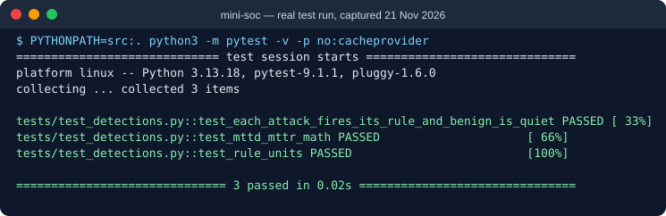

# Mini-SOC in a box — manual

*One page, eight blocks. Every figure here comes from this repository's own tests and README.*

## 1. Claim
Four detections score precision = recall = 1.0 on the labelled corpus, with MTTD and MTTR measured.

## 2. What it is
A small, reproducible detection lab. It generates labelled traffic with injected attacks, runs four tested detections, and scores them on whether they actually detect, not on how many alerts they raise. Each detection has an incident-response playbook.

## 3. Demo
Capture to record: the test run and the metrics output.


*Real output from this repository's own tests, captured 21 Nov 2026.*

## 4. Run it yourself
**Prerequisites:** Python 3.

```bash
PYTHONPATH=src pytest -q
```

## 5. What you will see
Every attack fires its rule and benign traffic stays quiet (precision = recall = 1.0 on the corpus).

## 6. 30-second talking point
> A SOC is judged by what it catches and what it ignores, not by alert volume. Each rule here is unit-tested and measured on labelled data, so a broken rule fails a test instead of failing silently.

## 7. Scope and limits
- A labelled test corpus. Real traffic has drift and novelty, so metrics must be re-measured against it.

## 8. Links
[Repository](https://github.com/fhionnghaile/mini-soc) · [Write-up](https://padraigfhionnghaile.com/work/mini-soc/) · [README](README.md)
